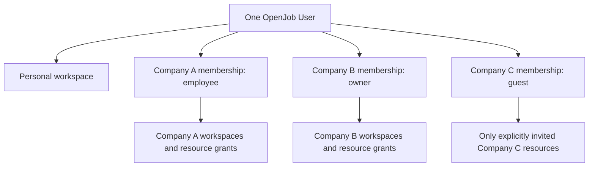

# Companies, people and workspace ownership

**Proposed — owner review pending.** This is a core part of the
[platform blueprint](PLATFORM_ARCHITECTURE.md), elaborating
[ADR 0020](adr/0020-propose-workspace-and-principal-boundaries.md).
Nothing here creates accounts, companies, invitations, connections or grants.

## Recommendation: one person, several independent contexts

A person has one OpenJob **User** per installation, one personal workspace, and
zero or more **Company memberships**. The same User can be an employee of Company
A, an owner of Company B and a guest of Company C. These are independent grants,
not separate duplicate logins or evidence of legal employment. A company never
owns the person's OpenJob identity merely by inviting or employing them.

A **Company** owns company workspaces, resource policies and company-owned data.
A **Workspace** is an authorized work area owned by exactly one Company or one
personal User. Resources belong to one workspace; they cannot have two company
owners. Company is the organizational isolation boundary, and workspace/resource
grants narrow access within it. Personal work has a separate ownership boundary.
Existing deployments remain separate trust boundaries; no global identity merge
across independent self-hosted installations is implied.

## Personal authentication and company-controlled sign-in

Recommend a personally controlled authentication/recovery anchor for the User.
A company-controlled login is a **company-context credential**, not a global
sign-in method that unlocks personal work or another company. Initially companies
invite existing personally authenticated Users; company SSO is disabled in the first Company release. Eligibility of independent
personal anchors is assessed without disrupting existing Personal access; see
[DOMAIN](build-spec/DOMAIN.md). If company sign-in is later supported, it authenticates only
that company's permitted context. Opening Personal or another company requires
an independent personal authentication or that other company's accepted proof.

The User controls personal sign-in linking/removal/recovery with fresh personal
proof; a company admin cannot reset the User's personal identity, add a global
method or recover another company. The company manages only its own identity
binding and membership. Before relying on company sign-in, require an independent
personal anchor so departure/reassignment cannot strand the person's identity.
An employee who has only a company login must establish that anchor before using
personal or multi-company contexts; removing the last independent anchor requires
replacement, not a downgrade to employer-only recovery.

Use verified provider subject and configured company/IdP binding to classify a
managed credential; email domain alone is insufficient. A managed/unknown-control
method cannot silently become a personal anchor. Existing global sign-in links
need assessment and an explicit compatibility policy before claiming this company
isolation. This target policy is not implemented by current Google/Apple linking.
Detailed protocol and migration design remains an acceptance prerequisite before
company-controlled login is enabled; no enterprise SSO infrastructure is assumed.

## What one OpenJob account can connect to and collaborate with

| Relationship | Sensible default |
| --- | --- |
| Personal Google/Apple or later sign-in method | Independently controlled global User proof after explicit linking; no Mail/Calendar consent |
| Company-managed login | Only an explicitly bound company-context proof; cannot unlock Personal or other companies |
| Personal Gmail/Outlook/standards mailbox | Connect to personal workspace; explicit provider consent; private by default |
| Company-provided individual mailbox/calendar | Connect within selected company under its resource policy; disclose company ownership and access before consent |
| Company shared mailbox/calendar | Company-owned connection/resource, explicitly assigned operators and access grants |
| Another company | Accept its invitation using the same User; independent role and resource grants |
| Another person outside the company | Invite as guest to named company workspace/resources; no company-wide access |
| Shared project across companies | One explicit owning company and guest grants, or a separately constituted joint company; never merge company boundaries silently |
| Personal agent or company agent | Distinct principal under explicit resource/operation grants and current provider authority |

Provider-specific restrictions still apply. An alias is not a separate mailbox;
knowing an email address or owning its domain grants no OpenJob access. An account
from a company-looking domain is not automatically company-owned. The connection
flow must identify the destination and ownership contract explicitly.

## Company creation and invitations

A User may explicitly create a Company and becomes its initial Owner. Creation
is distinct from connecting providers, granting an agent or provisioning external
accounts. Recommend one initial company workspace for deliberately shared work;
company invitations state that workspace's visibility before acceptance.

Owners/admins invite a person with a proposed company role and initial workspace
access. An invitation has an intended verified recipient, expiry and explicit
acceptance by the signed-in User. A new person creates their own identity; an
existing person adds membership to the same identity. No automatic email-based
User merging or domain-based enrollment. Invitations do not create invisible
employee accounts, attach personal provider credentials or activate agent grants.

Membership states are invited, active, suspended and departed. Only active
memberships can authorize work. Basic member-directory information may be visible
to company employees; guests see only collaborators needed for their assigned
work. Directory visibility is not permission to inspect private resources.

## Per-company roles and resource permissions

| Role | Recommended responsibility | Default limits |
| --- | --- | --- |
| Owner | Company policy, owner/admin assignment, ownership transfer and deletion decisions | Cannot take ownership of a User's personal workspace or unrelated company data |
| Admin | Invite/manage employees and guests, configure company-owned connections/workspaces within policy | Not an automatic mailbox-content reader or personal credential holder |
| Employee (member) | Use company workspaces/resources granted by policy; create work where allowed | No membership administration or access to other employees' restricted Mail |
| Guest | Collaborate on specifically invited workspaces/resources | No broad company directory, provider setup or company-wide discovery |

Roles apply independently per company. Workspace/resource grants can narrow
roles; they cannot expand them beyond company policy. Recommend explicit named
roles initially, not a configurable enterprise policy language. Company-wide
admin does not bypass provider consent or automatically receive private mailbox
read/send permission. Any administrative access to company-owned content must be
an explicit policy/action with attributable activity, not an invisible backdoor.

## Switching contexts

The app has a stable context switcher: Personal or a named Company, then an
accessible Workspace. The selected context scopes Today, Mail, Calendar, Tasks,
connections and agent management. Show the context near compose/send, sharing
and connection actions. Do not combine companies' inboxes, task searches or
agent resource pickers by default. Unfinished text belongs to its original
context and is not silently resubmitted in another context.

The API uses stable workspace/resource IDs and server-resolved membership. The
CLI selects a context explicitly and includes it in structured results. Context
selection is a request parameter, not authorization. Existing Task Groups must
receive an explicit compatibility mapping; current Group membership does not
turn into company employment or reveal personal Mail.

## Ownership, connections and agents

Personal resources belong to the personal workspace and remain private after a
company membership changes. Company Tasks, workspaces, calendars and shared
connections belong to that company. A restricted employee mailbox can still be
company-owned without granting every colleague content access. The product must
make ownership and effective access visible rather than calling both cases
simply "my account."

A connection records workspace/company ownership, verified upstream account,
consented operations, credential reference and current human/service controller.
OpenJob ownership and upstream authorization are separate: a company admin cannot
reuse a departed employee's OAuth credentials by assigning a new label. Company
continuity needs an appropriate provider-supported service/admin/shared-mailbox
binding or renewed consent from an authorized replacement. Never copy a personal
connection into company ownership merely because it was used for company work.

Personal agents are controlled by a User. Company agents are controlled by a
Company with named authorized managers and an attributable initiating/sponsoring
human. Both are separate principals. A personal agent accessing company work
needs company-permitted delegation by an active member; the person's access to
another company never carries over. A company agent has no implicit access to
managers' personal workspaces. Its credentials/grants cannot outlive the company
policy or provider binding they depend on.

Effective agent authority is the intersection of company/workspace policy,
resource grant, current delegating human or approved company-service authority,
agent operations, provider consent and connection state. Company-service grants
need their own explicit lifecycle; they do not become perpetual employee tokens.
No agent provisions company users, changes grants or connects providers merely
because it can read Mail or write Tasks.

## Departure, transfer and cross-company work

- Suspend/depart membership first stops that member's company access and
  delegations derived from it. Personal identity, personal resources and unrelated
  memberships remain intact. Company records and shared work remain company-owned.
- Reassign company Tasks and company-agent management explicitly. Transfer of the
  last Owner must establish a successor; a company cannot silently become ownerless.
- Connections owns credential/revocation cleanup. Remove personal delegated
  bindings; reconnect company resources with proper upstream authority where
  required. An unavailable provider leaves visible pending cleanup, not claimed
  completed revocation. Previously downloaded content cannot be recalled.
- Private source links in shared Tasks remain unavailable unless the recipient
  separately has source access. Sharing a Task never copies its Mail body or
  introduces a cross-company read grant.
- Cross-company collaboration uses explicit guest invitations into one owner's
  named resources. A Company B employee invited into Company A acts as a guest of
  A; that does not invite B's colleagues, expose A to B or transfer resource ownership.

Identity/Workspace coordinates lifecycle changes; Delegation stops grants;
Connections owns provider/credential cleanup; Mail/Calendar invalidate projections;
Tasks preserves company-owned work and reconciles its planning links. Retention
and actual provider cleanup outcomes must be distinguishable from local access
revocation. Concrete proposed durations and cleanup defaults are in
[RUNTIME](build-spec/RUNTIME.md), pending owner review and implementation proof.

## Tradeoffs and implementation implications

This gives people continuity across jobs and companies meaningful ownership
without fragmenting identity. It requires explicit membership and resource grants,
context-scoped queries, ownership-aware connection setup and lifecycle coordination.
The current owner-ID personal aggregate and separate Groups do not implement it.

Separate logins per employer simplify isolation but fragment a person's work and
create duplicate linking/recovery paths. A flat shared workspace with no Company
entity is smaller but cannot express employer ownership, policy and departure
clearly. Domain-based automatic membership is convenient but misidentifies people
and grants access without invitation. A global cross-company inbox is convenient
but makes context and sending identity ambiguous. We recommend the explicit model
above, with basic roles and one company workspace first; enterprise federation,
complex org hierarchy and fine-grained custom policy remain future scope.

Detailed entity, role and effective-authorization contracts live in
[DOMAIN](build-spec/DOMAIN.md); [PRODUCT](build-spec/PRODUCT.md) supplies stable
requirements and [EXPERIENCE](build-spec/EXPERIENCE.md) supplies screen/flow states.
All remain Proposed parts of this design.
