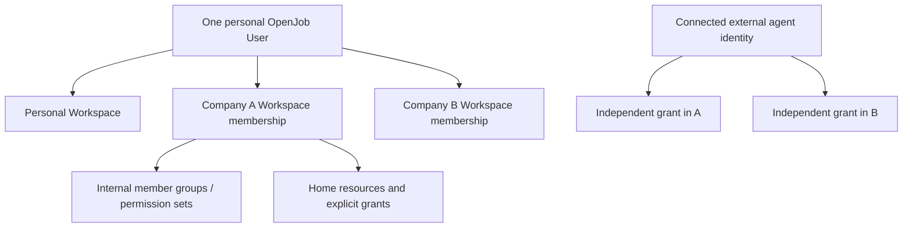

# People, Workspaces and explicit access

The [owner-confirmed core](ARCHITECTURE_ALIGNMENT.md) supersedes the previous
Company → Workspace proposal. A company **is a Workspace** initially. This file
elaborates that core; details labeled Proposed are not adopted by that confirmation.
No accounts, grants, implementation or access are created by this document.

## One identity, multiple Workspaces

One personal OpenJob User participates in independent Personal, company or family
Workspaces. Each has exactly one accountable human owner. Internal member groups
and permission sets organize access; they do not introduce a Company hierarchy.
Resources have one home Workspace and remain attached through membership changes.
Human administrative ownership does not transfer upstream credentials or grant
automatic access to restricted content. Independent installations remain separate
trust boundaries; identity federation is not implied.

## Membership, ownership and departure

Invitations identify an intended recipient and selected resource/action grants.
Joining a Workspace never exposes all Mail, calendars or tasks. Restricted
individual and selected shared mailboxes coexist. Grants can address people,
internal groups or connected agents without creating cross-Workspace authority.

A Workspace has one owner, not multiple Owners. The current owner proposes transfer
to another member, who accepts before the transfer takes effect. The current owner
cannot leave first. Resources, membership and grants stay with the Workspace;
transfer changes accountable administration, not source consent or mailbox privacy.
Other departing members lose that Workspace's access and derived agent grants;
Personal and other Workspaces stay intact. Reassignment of tasks/control is explicit.

**Proposed details:** invitation expiry/single use/verified-recipient acceptance;
membership invited/active/suspended/departed; Admin/Employee/Guest presets in
[DOMAIN](build-spec/DOMAIN.md). Presets do not replace explicit grants or establish
legal employment. Default shared TaskSpace/calendar creation also remains proposed;
invitation recipients must see any initial grants before accepting.

## Central Connections, resources in their home Workspace

One account-level Connections screen lists only connections the human may manage
across their Workspaces. A provider binding can expose multiple resources; each
mailbox/calendar has a chosen home Workspace and its own access boundary. There is
no master owning Workspace, global Mail grant or administrative bypass. Central
navigation does not settle where provider credentials are stored.

The proposed binding/resource schema must support that distinction. Connecting or
reconnecting never changes a resource's home or shares it merely because another
resource came from the same provider account. A Workspace owner cannot reuse a
departed member's provider credential by assigning a new name. Continuity needs
provider-supported authorization or explicit renewed consent. An alias remains a
send identity, not an isolated mailbox. OpenJob accounts initially host no email.

## Connected agents and human control

An external agent connects as a separate authenticated identity. The same identity
may receive different, independently revocable grants in several Workspaces.
OpenJob stores authorization and activity; it does not host a persistent agent
per Workspace. A member can delegate a subset of their current rights only when
Workspace policy permits member-connected agents. Removing/revoking A's grant
must leave unrelated B grants alone. Departing A invalidates grants derived from
that member's A authority even if the agent connection itself remains available.

**Proposed details:** exact credential binding/lifetime and grant UI, reviewed
mailbox-set snapshots, operation vocabulary and sponsor-derived dispatch checks in
DOMAIN/CONTRACTS. No new unattended Workspace-service grant is inferred. Agents
receive neither a human session nor upstream credentials. Access administration
remains a proposed human-only first-core boundary.

## Home and actions

Home can show authorized tasks, events and unread counts across Workspaces, with
clear labels and no hidden-source metadata. Selecting an item enters its home
Workspace. Mail/Calendar/Tasks actions and agent grants always use an explicit
Workspace context. Context switching cannot retarget a draft, consent callback,
queued send or cached edit. Home aggregation is not unified cross-Workspace Mail
search or additional content access.

## Proposed authentication and lifecycle details

Independent personal authentication/recovery protects one identity across jobs.
Company-managed SSO remains disabled in the proposed initial implementation;
current Google/Apple linking needs eligibility assessment before claiming employer
isolation. Unknown control is not automatically independent; preserve existing
Personal use while assessing it. These protocol/eligibility defaults remain
Proposed, not additional owner-confirmed decisions.

Identity/Workspace coordinates departure/deletion; Delegation disables derived
grants; Connections owns provider/credential cleanup; Mail/Calendar invalidate
readable projections; Tasks preserves Workspace work and reconciles planning.
Local denial is distinct from completed provider cleanup or physical erasure.
Proposed durations/storage/cleanup are in [RUNTIME](build-spec/RUNTIME.md).

Useful legacy Task Groups do not automatically become Workspaces or internal
member groups. Preserve actual users/data/consumers deliberately; disposable
fixtures need no migration program. Implementation must verify relevant ownership,
invitation, transfer, restricted-Mail and agent revocation boundaries before live use.
