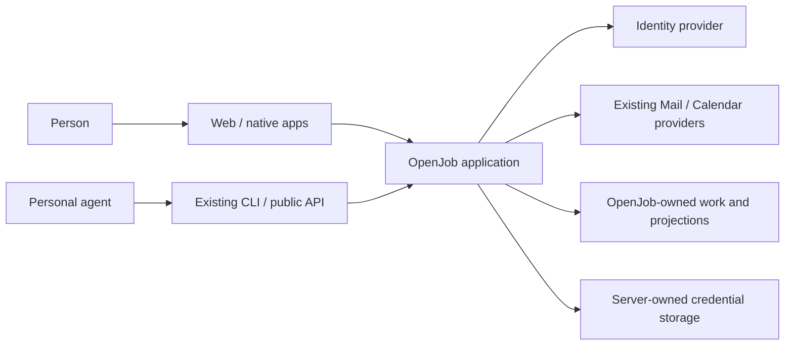
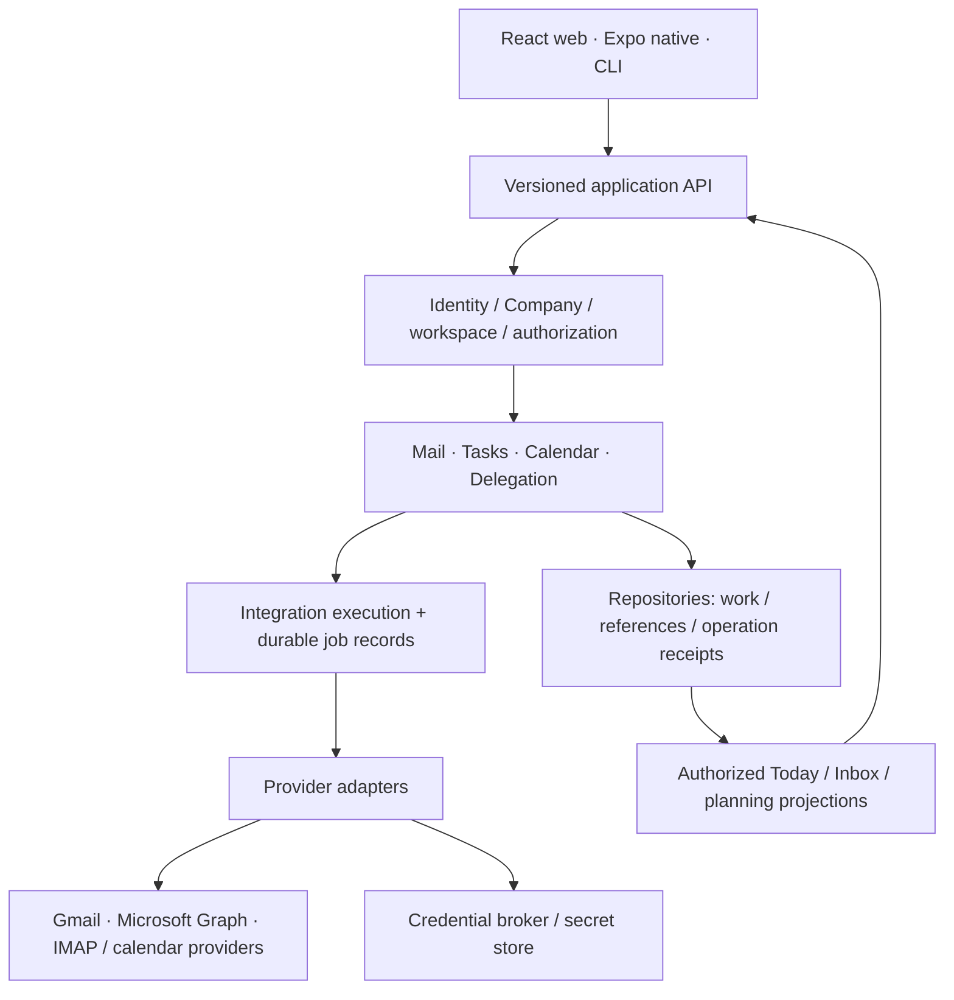

# OpenJob platform blueprint

**Status: Proposed for owner review — 16 October 2026.** This is a target
architecture, not an implementation or infrastructure authorization. The
[master mission](MASTER_MISSION.md) remains the product mandate; Linear remains
the execution queue. New feature implementation pauses until this blueprint is
reviewable. Baseline inspected: `9ba3929fbf0ccc3e24e2577410a355fa3798736e`.
## 1. Product charter

OpenJob is a workspace where a person and their authorized agents turn incoming
communication into completed, planned work across the accounts they already use.
Its organizing unit is **work with context**: a conversation, the action it
requires, the time reserved for it, and the reply or outcome that closes it.

The first intended user is an independent professional managing several personal
and work accounts. Company owners/admins establish shared work for employees and guests; a person
may belong to several companies while keeping a personal workspace. Collaborators
share selected work without inheriting private mailbox access. An optional personal agent is a
separate principal acting for a person, not a substitute for a complete human app.

A successful first product lets someone connect an existing account, understand
what needs attention, turn a message into a Task, plan it, complete it, and return
to the correct conversation and sending identity. The same authorized actions
are available through the app and existing CLI. Value is measured by finishing
that work with less context switching, not by counting modules or integrations.

Platform scope: Mail, Calendar, Tasks, Connections, identities, permissions,
agent activity and the integration mechanisms that join them. Web and native
clients share semantics; local operation grows deliberately. Existing Group work
remains useful. Companies, personal workspaces and independent company memberships are core
platform concepts, even though the prototype does not implement company tenancy.

Non-goals: hosting mailboxes; duplicating Google/Microsoft identity or storage;
a documents/chat/office suite; a generic agent runtime; a plugin marketplace;
full enterprise directory/federation suites, billing and speculative multi-region
infrastructure. Basic company ownership, invitations and roles are in scope.
The planning discipline should support a large system; the initial deployment
should remain small. No forced account migration or AI subscription is required.

Principles: provider authority stays explicit; private context is private by
default; humans and agents use one capability model; changes have understandable
outcomes; clients share contracts; boundaries precede service extraction; preserve
working npm/Node/TypeScript/React/Expo/Firebase/Cloudflare components.
## 2. Experience and capability map

Navigation target: **Today · Mail · Tasks · Calendar · Agents**, with
**Connections** and account/workspace controls consistently accessible. Today is
an overview and entry into work, not a fourth system of record. Navigation and
layout can differ on phones while keeping those destinations and relationships.

| Journey | Product capability | Current evidence | Target architecture needed |
| --- | --- | --- | --- |
| Form or join companies | Create a company, invite employees/guests, accept independent memberships, switch context | Not implemented; personal owner and separate Group models only | Company ownership, membership/role lifecycle, workspace/resource grants and explicit invitations |
| Start and connect | Sign in, choose workspace, connect accounts, see granted operations and sync status | Existing OpenJob identity; connector status and mock consent; no live connection UI/runtime | Identity + membership resolution; connection lifecycle; approved OAuth callback/secret broker |
| Triage and reply | Account-aware Inbox, read/search, decide reply or action, draft and explicitly send from correct account | Invented saved Mail and draft/simulated Sent flow; provider read mappers tested with injected transports | Mail context with provider projections; durable reads/sync; separately authorized draft/send adapters |
| Mail to Task | Preserve source conversation while creating or reopening private work | Real prototype API/CLI/UI operations, private links and roundtrip navigation | Stable connection-qualified references; explicit sharing policy; no copied private mail into Group Tasks |
| Plan the day | See open work and commitments, reserve time, revise plan, complete work | Saved OpenJob calendar blocks, conflict-aware suggestions and iCalendar exchange | Calendar ownership split; external calendar read/write adapters; day projection over Tasks and calendars |
| Delegate work | Give an agent a named job and limited resources; review actions and revoke | Hashed, expiring scoped personal grants and CLI/API actions; simulation only for mail sending | Distinct agent principal, explicit delegation, operation receipts; pending work rechecks current grant |
| Move between devices | Continue the same work with visible offline/sync state | Web/native Tasks/Calendar offline mechanisms; local npm saved fixture; device acceptance incomplete | Deliberate local-cache/server authority model, consistent contracts and platform-specific release proof |

First-run target: sign in → Personal or accepted Company/workspace → choose provider and operations →
provider consent → verify identity and initial Inbox → first useful action.
Examples are a separate explicit path with persistent labels; adding examples
must never look like connecting an account. No unusable Connect button should
stand in for missing runtime setup. A blocked connection names the missing setup
and allows work on OpenJob-owned Tasks/Calendar to continue.
## 3. Domain boundaries

| Bounded context | Owns | Must not own |
| --- | --- | --- |
| Identity and Workspace | User IDs, sign-in links, Companies, invitations, memberships, workspace ownership and principal resolution | Provider mailbox passwords; inference of membership from matching email |
| Connections | Provider identity binding, approved scopes, credential references, lifecycle and sync eligibility | General Task state or client-visible credentials |
| Mail | Mailbox/message/thread references, provider projections, draft intents, sending identity and outcomes | Provider truth for arbitrary folders or an invented universal thread model |
| Tasks | OpenJob work items, completion, optional source references and planned interval relationship | Copies of private source mail in shared Group work |
| Calendar | OpenJob blocks, links to planned Tasks, external calendar references and availability projection | Implicit authority to edit a provider event because it was read |
| Delegation and Activity | Agent principals/grants and attributable operation history | Human session reuse or upstream provider credentials for agents |
| Integration execution | Durable operation/sync jobs, cursors and delivery receipts | A second business policy implementation outside the domain services |

Domains are modules with named repositories and application operations, initially
in one application. Read projections such as Today and search compose authorized
results; they do not create independent copies that become authoritative.
Cross-domain workflows belong to application orchestration, not UI side effects.
Tasks owns the canonical planning relationship to an OpenJob block; Calendar
owns the block interval. The scheduling application operation coordinates both
repositories transactionally, including reschedule, unschedule and deletion.
An external provider event uses a separate integration intent/result, not that
local transaction.
## 4. System context and containers

The boxes identify responsibilities, not a mandate for separate services. The
API and job runner can share a codebase/deployment with different invocation
modes. Long-lived connections or background execution may later require a
separate process; only measured provider/runtime needs justify that split.
See [ADR 0019](adr/0019-propose-modular-platform-and-runtime-boundaries.md).
## 5. Identity, tenancy and authorization

Recommend one immutable User per installation with a personal workspace and
independent memberships in multiple Companies. A Company owns company workspaces
and resources; each Workspace belongs to exactly one Company or a personal User.
Company policy establishes the organizational boundary; workspace/resource grants
narrow it. Company-controlled login is restricted to its company context; personal
identity/recovery requires an independent personal anchor, not employer control. Roles (Owner/Admin/Employee/Guest) apply per company. Employment never
owns a person's identity or personal accounts. Membership alone does not expose
restricted mailbox identities, connections or projections.

The app/CLI selects Personal or Company and Workspace explicitly; authorization
resolves membership and grants server-side. Company creation and invitations are
explicit, with verified recipient acceptance; matching email/domain does not
create membership. Cross-company work uses guests in explicitly owned resources,
not a merged tenant. Existing Groups require a deliberate compatibility mapping.

Personal and company agents have distinct controlling owners; authority intersects
current delegation/company policy, resource access and provider consent/state.
Company departure removes only that context's access and derived grants. Company
records remain company-owned; personal data and unrelated memberships remain
intact. Transfers and connection reauthorization are explicit.

See [Companies and identity](COMPANIES_AND_IDENTITY.md) for the recommended role,
invitation, connection ownership, switching, departure and collaboration model,
and [ADR 0020](adr/0020-propose-workspace-and-principal-boundaries.md) for alternatives.
## 6. Authority, data and integration

| Record | Authority | OpenJob representation |
| --- | --- | --- |
| User, Company, workspace, membership, grant | OpenJob, with identity-provider proofs | Stable IDs and explicit relationships |
| Provider connection | OpenJob consent/binding metadata; provider verifies upstream identity | Workspace + connection ID, provider subject, capabilities, secret reference |
| Mail content and provider calendars | External provider | Connection-qualified references and bounded projections/cursors |
| Personal/company/Group Task | OpenJob | Task plus resource scope, completion and optional private source reference |
| OpenJob calendar block | OpenJob | Owned interval and optional Task relationship |
| Draft/send operation | Explicit chosen storage/destination | OpenJob draft or provider draft distinguished; durable intent/result, chosen identity |
| Activity and sync receipts | OpenJob observations | Attributable operation IDs/outcomes; not proof of unseen provider state |

The target connection identity is `(workspaceId, connectionId, providerSubject)`;
external object references additionally identify record kind and provider object
ID. Address, label and thread IDs alone are insufficient. Provider-specific
thread/folder semantics stay behind adapters rather than being flattened away.
A disconnected source link can retain a minimal reference/unavailable state while
Tasks remain usable; retained message bodies and retention policy require an
explicit decision before a production cache is enabled.

Connection lifecycle: requested → consent pending → verified → active, with
reconnect-required/revoked/disabled states. Each operation checks its advertised
capability; read consent does not imply draft/send/calendar write permission.
Credentials resolve server-side against current binding. No app screen, CLI
response or agent grant contains upstream credentials.

Use synchronous transactions for OpenJob-owned changes that must agree, such as
Task scheduling and its OpenJob block. For external operations, first persist an
operation intent; execute through a connector; record provider identity/outcome;
update projections. Domain facts may fan out through a transactional outbox/job
record in the same store. Do not introduce an event bus or event sourcing merely
to join three modules. Events contain references and necessary metadata, not raw
mail bodies by default. There is no cross-provider distributed transaction.

Synchronization is incremental where supported, paged/polled where necessary,
and visibly stale or blocked when it cannot progress. Notifications/webhooks are
hints to read authoritative provider state. A durable runner owns retries and
cursors; in-memory request work is not a reliable sync service. At-least-once
execution requires operation receipts and provider-specific reconciliation;
ambiguous sends require review rather than a blind resend. These are execution
semantics, not a separate multi-month resilience program.

Client offline work is a bounded projection plus explicit pending edits, not a
second provider authority. Reconnect reconciles with the authoritative service;
provider consent and real sending are unavailable offline. A local installation
can eventually be its own authoritative service, but its secure credentials,
background lifecycle and optional hosted sync need a separate deployment profile.
See [ADR 0021](adr/0021-propose-provider-authority-and-integration-execution.md).
### Lifecycle ownership

| Transition | Accountable context and effect |
| --- | --- |
| Disconnect / provider revocation | Connections first blocks execution and credential resolution, then owns durable credential/provider-revocation cleanup; Integration execution stops pending jobs; Mail/Calendar invalidate readable projections |
| Human leaves Company/workspace | Identity/Workspace removes membership; Delegation disables affected grants; Connections resolves privately controlled accounts through explicit removal/transfer, never automatic disclosure to remaining members |
| OpenJob account/workspace deletion | Identity/Workspace coordinates inactive state and context-owned cleanup; queued work loses authority first; each context reports pending/completed cleanup |
| Task or OpenJob block removal | Task-planning application operation reconciles the canonical relationship; remote provider deletion requires a separate explicit supported operation |

A retained Task may retain only an unavailable source reference after disconnect;
that is not permission to retain or reveal message content. Retention periods,
search-index erasure and activity receipts need explicit policy before live data.
Connections remains responsible for cleanup completion even when a provider is
unavailable; a UI status cannot falsely report external revocation as completed.
## 7. Interfaces, deployment and growth

One versioned API/OpenAPI contract serves the human apps, existing CLI and agent
clients. Domain operations authorize the same way regardless of caller. UI
controls expose only available operations; CLI output retains IDs, pagination,
structured errors and operation state. A future MCP interface is a thin client,
not a new permission or business-logic layer. Native controls/layout may differ;
semantics should not. Preserve [ADR 0001](adr/0001-web-and-cli-are-equal-api-clients.md)
while explicitly designing any future local-service profile.

Keep the current hosted Cloudflare application and Firebase/Firestore components
while they earn their place. First separate domain repositories and integration
execution responsibilities in code. Evaluate storage/query needs against an
actual connected Inbox before choosing a new database. WStack's Rust/PostgreSQL
preferences guide justified new components; they do not authorize a rewrite.

The installed Node app currently packages a synthetic local API, not a privately
hosted production account server. Hosted, local demo and eventual self-hosted
profiles must have explicit identity, storage, secret and background-job bindings.
Recommended first live-provider profile: the existing hosted service, because
identity and remote API clients already exist. This is proposed, not accepted.
A secure local-service-first choice would instead need explicit identity, local
secret storage, background lifecycle and remote-agent access decisions before
implementation. Local CI/publishing preference does not determine where the app
service is hosted. The shared domain/API boundaries can be reviewed independently
of this deployment choice. Keep development/production resources separate. No new infrastructure, secrets,
routes, provider registration or security grants are authorized by this document.

Owner preference: local Mac CI/package/publish, manual-only Actions. Reviewed
artifacts retain source/version/channel identity; npm publishing, hosted deploys
and native store releases are separate actions with their applicable approval.
Keep existing native/privacy release decisions; design review is not release proof.

Extend through documented domain operations and provider adapter capabilities.
Extract a service only for a demonstrated independent lifecycle, runtime,
isolation or scaling need. Search indexing, queues and analytics are supporting
projections, introduced when an observed product need warrants them.
### Operating assumptions

Keep an interactive API request focused on bounded work; page provider reads and
move long-running sync to the runner. Observe operation outcomes, connection lag,
queue age and user-visible failures before setting capacity/SLO targets. No user
scale, availability percentage or multi-region requirement has been established.
Logs use operation/connection identifiers with redacted diagnostics, not bodies,
credentials or bearer tokens. Before real production Mail storage, decide access,
retention/deletion, backup/restore ownership and hosting/data-location constraints
alongside the existing privacy inventory. These obligations belong to the chosen
deployment profile; a successful demo or source build does not satisfy them.
## 8. Prototype assessment and phased outcomes

Current source supports a useful invented-data vertical slice. It does not yet
provide the proposed workspace platform or real connected-account experience.

| Current evidence / code | Architectural gap |
| --- | --- |
| `server/v1-runtime.ts`, `db/personal-workspace.ts`: hosted identity/API, owner aggregate with CAS and bounded JSON | No Company or general workspace/membership model; aggregate cannot be the eventual full Inbox store |
| `shared/workspace-engine.ts`, `shared/personal-workspace.ts`: shared operations; OpenAPI + CLI | Prototype command surface needs evolution into stable context-owned operations, not duplicate engines |
| `server/providers/provider-connections.ts`, token-vault and OAuth modules | Mock-only execution; missing approved production callback, secure store/refresh and runtime bindings |
| Gmail/Outlook/IMAP read adapters; provider-preview API | Translation proof is not live connection/sync or integrated authoritative Mail; IMAP WLK-302 checkpoint remains unrecovered |
| `app/workspace/*`, native personal workspace, offline projections | Fragmented app entry/provider preview; no first-run product flow or consistent platform navigation |
| `scripts/personal-workspace-test-server.mjs`, npm packaging | Full local prototype works with invented identities; no production local credential or background model |
| Scoped grants/activity and existing scheduled account-deletion work | No durable provider integration runner/outbox or provider write lifecycle |

Phases are outcome/dependency proposals, not a parallel backlog. Owner review
selects the next milestone in Linear; no new feature is started by this blueprint.

1. **Agree the platform contract.** Review this charter, domain ownership and ADRs;
   settle Company/personal ownership, membership/resource grants and the first deployment profile.
2. **Establish ownership and connect work.** Establish personal/Company ownership,
   invitations, independent memberships and context selection before live data.
   Approve one provider/development account; implement connection lifecycle,
   real paged Inbox/reconnect, durable projections and the first-run shell.
   Acceptance must include three people and two Companies: Alex is Employee in A
   and Admin in B; Sam owns A with no B membership; Jo owns B and is Guest in A.
   Each retains personal work. Demonstrate invitation/acceptance, role-scoped
   resource visibility and context switching, with no automatic cross-company or
   personal access. Alex leaving A must preserve personal work and B membership.
   Read → linked Task → plan → local draft must finish as one journey.
3. **Close the work loop.** Add separately consented provider draft/send and
   calendar operations, clear sending identity/outcomes, durable integration jobs,
   and useful scoped agent jobs using the same operations. Prove a permitted job,
   a denied action and human revocation in the actual experience.
4. **Broaden the platform.** A second provider/account and cross-company guest
   collaboration with explicit ownership; then
   supported offline/local deployment and cross-device acceptance. Split
   stores/processes only when evidence shows the current boundary is insufficient.

Review decisions: accept/adjust ADRs; choose hosted-first versus a secure local
service as the first live-provider profile; select the first approved provider;
confirm Company creation/roles, private versus company-owned work and explicit
cross-company collaboration defaults. Open questions include retention/search of
mail projections, company administration and provider grant continuity, provider refresh/job hosting,
and the eventual local-to-hosted sync contract. None is silently resolved by a demo.
